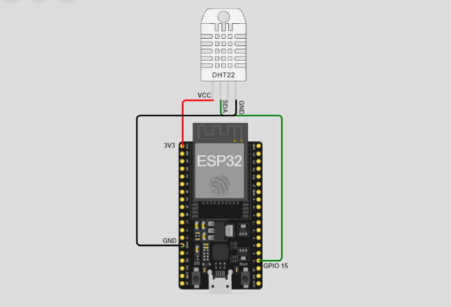
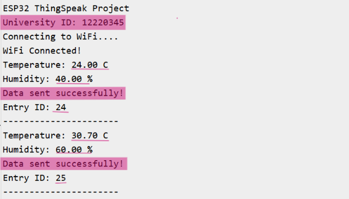
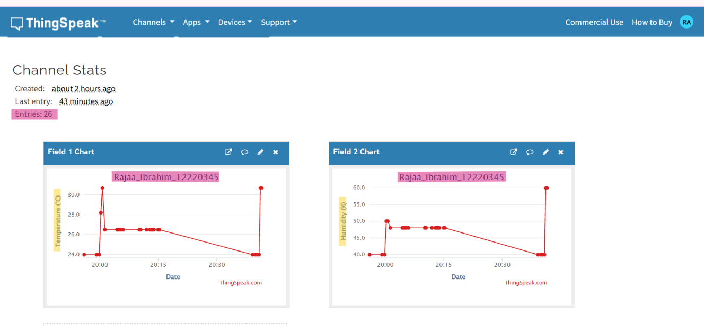

# ESP32 Temperature and Humidity Monitoring Using ThingSpeak

## 1. Project Description

This project demonstrates an Internet of Things (IoT) system that monitors temperature and humidity using an ESP32 microcontroller and a DHT22 sensor.

The project is developed using the Wokwi online simulator, so no physical hardware is required.

The ESP32 connects to Wi-Fi, reads temperature and humidity values from the DHT22 sensor, and sends the readings to ThingSpeak every 20 seconds.

ThingSpeak stores the data and displays it using two publicly accessible graphs.

## 2. Student Information

- **Student Name:** Rajaa Ibrahim
- **University ID:** 12220345
- **Project:** ESP32 to ThingSpeak IoT Monitoring

## 3. Components and Tools

- ESP32 DevKit V4
- DHT22 Temperature and Humidity Sensor
- Wokwi Online Simulator
- ThingSpeak IoT Platform
- Arduino (C++)
- Wi-Fi and HTTP Communication

## 4. Circuit Connections

The DHT22 sensor is connected to the ESP32 as follows:

| DHT22 Pin | ESP32 Pin |
|---|---|
| VCC | 3V3 |
| SDA (DATA) | GPIO 15 |
| GND | GND |

The circuit was designed and tested using Wokwi.

### Circuit Diagram



## 5. How the System Works

1. The ESP32 connects to the Wokwi-GUEST Wi-Fi network.
2. The DHT22 sensor measures temperature in Celsius and humidity as a percentage.
3. The ESP32 reads the sensor values.
4. The readings are sent to ThingSpeak using an HTTP GET request.
5. ThingSpeak stores the readings in two separate fields.
6. The process repeats every 20 seconds.
7. The collected data is displayed using ThingSpeak charts.

## 6. ThingSpeak Configuration

A ThingSpeak channel was created with the following settings:

**Channel Name:** Rajaa_Ibrahim_12220345

**Channel ID:** 3549930

| Field | Description |
|---|---|
| Field 1 | Temperature (°C) |
| Field 2 | Humidity (%) |

**Public ThingSpeak Channel:**

https://thingspeak.com/channels/3549930

## 7. Wokwi Simulation

The ESP32 and DHT22 sensor were simulated using Wokwi.

**Wokwi Project Link:**

https://wokwi.com/projects/478873862121993217

The simulator allows temperature and humidity values to be changed manually to test real-time data updates.

## 8. How to Run the Project

1. Open the Wokwi project using the link above.
2. Open the `sketch.ino` file.
3. Create a ThingSpeak channel with two fields for temperature and humidity.
4. Open the ThingSpeak API Keys tab and copy your Write API Key.
5. Replace `INSERT_THINGSPEAK_WRITE_API_KEY` in the code with your own Write API Key.
6. Start the Wokwi simulation.
7. Open the Serial Monitor to view sensor readings and HTTP responses.
8. Open the ThingSpeak channel to view the updated graphs.

**Note:** The real Write API Key is not included in this public repository for security reasons.

## 9. Testing and Results

The project was tested successfully using the Wokwi simulator.

The ESP32 connected to Wi-Fi and sent temperature and humidity readings to ThingSpeak.

Example sensor readings:

- Temperature: 24.00 °C
- Humidity: 40.00%

The Serial Monitor displayed:

```text
ESP32 ThingSpeak Project
University ID: 12220345
Connecting to WiFi...
WiFi Connected!
Temperature: 24.00 C
Humidity: 40.00 %
Data sent successfully!
Entry ID: 24
```

The ThingSpeak channel recorded multiple readings and displayed temperature and humidity changes over time.

### Serial Monitor Output



### ThingSpeak Charts



## 10. Project Files

```text
ESP32-ThingSpeak-Temperature-Humidity/
|
|-- sketch.ino
|-- diagram.json
|-- libraries.txt
|-- README.md
|
|-- screenshots/
    |-- wokwi_circuit.png
    |-- serial_monitor.png
    |-- thingspeak_charts.png
```

## 11. Conclusion

This project demonstrates how an ESP32 can be used in an IoT application to monitor environmental conditions.

Using the Wokwi simulator and ThingSpeak platform, temperature and humidity data were successfully collected, transmitted through Wi-Fi, and visualized using online charts.

The project provides a simple example of cloud-based IoT monitoring.
